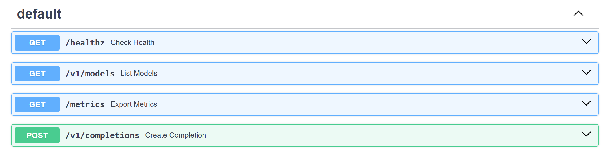

# Phase 1: naive generation

Qwen3-0.6B in plain PyTorch, served over the standard OpenAI-style API. There is **no KV cache**:
every new token runs the whole sequence through the model again. There is no batching: requests
are served one at a time, and the rest wait in a queue. Every later phase is checked against the
greedy outputs of this phase.


## What is inside

| Module | Job |
|---|---|
| `qwen3_model.py` | Decoder: embeddings, RMSNorm, RoPE, grouped-query attention with QK-norm, SwiGLU MLP, tied output head. Uses the checkpoint's parameter names |
| `weight_loader.py` | Downloads config, tokenizer and safetensors with `huggingface_hub`, then loads them onto the meta-built model |
| `text_tokenizer.py` | Encode and decode, stop tokens from the configs, incremental decoding that never splits a UTF-8 character |
| `sampling.py` | Greedy, temperature and top-p, with a seeded generator per request |
| `naive_generator.py` | The no-cache loop: forward the full sequence, sample, append, repeat |
| `engine_loop.py` | One background task serves one request at a time. Model steps run in a worker thread so streaming keeps flowing |
| `api_routes.py`, `completion_responses.py` | `/v1/completions` (JSON or SSE, token-ID or text prompts, `ignore_eos`, `stream_options.include_usage`), `/v1/models`, `/healthz`, `/metrics` |
| `step_timing.py` | Measures one step's time at growing sequence lengths |

## Correctness

- Logits match Hugging Face `transformers` (fp32, CPU) within 1e-4 for random weights, and within
  1e-3 for real Qwen3-0.6B weights with identical argmax. Run the real-weights check with
  `NANOENGINE_TEST_REAL_WEIGHTS=1`.
- Greedy generation gives the same tokens as `transformers` `generate()`.
- Greedy reference outputs for the equivalence suite: `engine-harness/reference/greedy-reference.json`
  (CPU, fp32).

## Results on CPU (i7-1165G7, fp32)

A real streamed response. The engine sends one SSE chunk per token, then a usage chunk, then `[DONE]`:


**Step time grows with sequence length.** Without a KV cache, every new token re-runs the whole
sequence. At 1,024 tokens, one token takes 15 s. Phase 2 caches keys and values to flatten this line.


| Sequence length | 16 | 64 | 128 | 256 | 512 | 1024 |
|---|---|---|---|---|---|---|
| Step time (ms, median) | 873 | 1,584 | 2,452 | 4,533 | 9,718 | 15,284 |

Even at 16 tokens, a step costs about 0.87 s. That cost is mostly reading 0.6B fp32 weights, about
2.4 GB, from memory on every step.

**One request at a time.** Total throughput stays flat as users increase. Extra users only wait
longer in the queue (short_chat, `cpu` scale):

| Users | Total tok/s | TTFT p50 | ITL p50 | E2E p50 |
|---|---|---|---|---|
| 1 | 1.2 | 0.7 s | 772 ms | 25 s |
| 2 | 1.2 | 28.6 s | 830 ms | 56 s |
| 4 | 1.3 | 74.7 s | 775 ms | 99 s |

Harness outcomes ([full report](results/cpu/harness-report.md)): 4 passed, 2 expected failures
(concurrency, prefix reuse), 1 skipped. Equivalence: 10/10 greedy outputs identical to the reference.

For scale: vLLM on a T4 serves this workload at 7 ms per token for one user, and 1,928 tok/s total at
64 users (see the [root README](../README.md)).

## Run

```powershell
python -m venv .venv
.\.venv\Scripts\python.exe -m pip install torch --index-url https://download.pytorch.org/whl/cpu
.\.venv\Scripts\python.exe -m pip install -e ".[dev]"
.\.venv\Scripts\python.exe -m pytest                     # unit tests, 80% coverage
.\.venv\Scripts\python.exe -m nanoengine                 # serves on :8000 (settings: .env.example)
.\.venv\Scripts\python.exe -m nanoengine.step_timing     # results/step-time-vs-length-*.md/.png
```

The running engine exposes the standard API (FastAPI docs page at `http://localhost:8000/docs`):



Harness, from `engine-harness/`:

```powershell
$env:HARNESS_ENV_FILE="../01-naive-generation/harness/cpu.env"
.\.venv\Scripts\python.exe -m pytest tests/suites -rxXs
```

On a Kaggle T4 (fp16): `python kaggle/run_on_kaggle.py 01-naive-generation --owner <kaggle-user>`.

## Expected harness outcomes

| Suite | Outcome | Why |
|---|---|---|
| streaming, latency, capacity, equivalence | pass | |
| concurrency | expected fail | one request at a time, so more users add no throughput |
| prefix_reuse | expected fail | nothing is cached |
| long_prompt_interference | skipped | without batching, a running stream is never interrupted |
