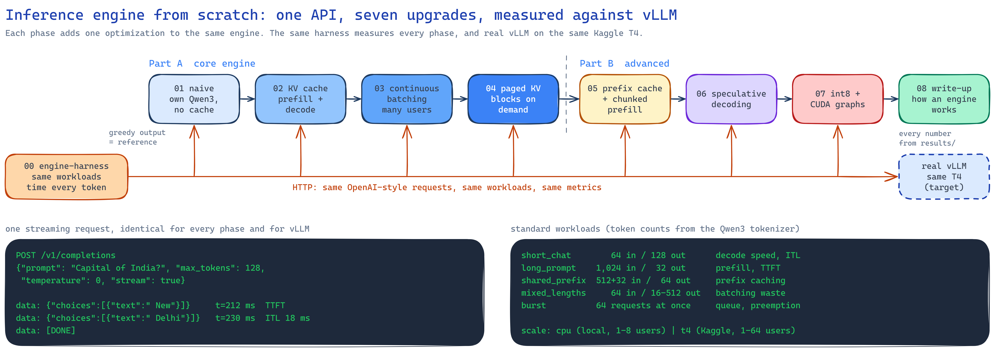
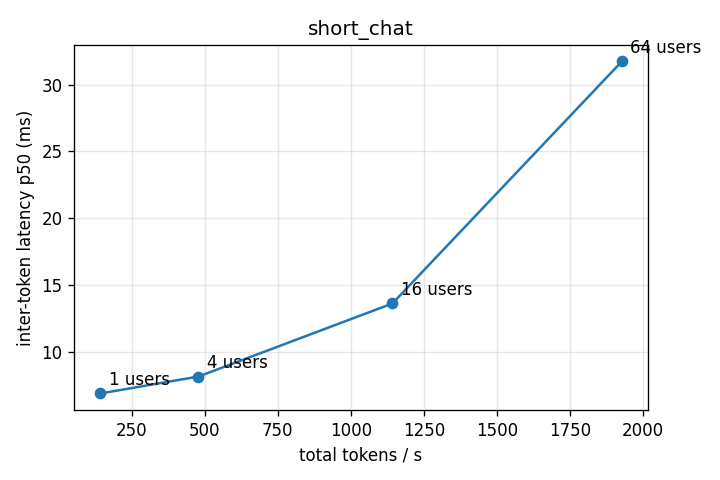

# inference-engine-from-scratch

An LLM inference engine for Qwen3-0.6B, built one optimization at a time. Each phase is its own
folder. A shared harness measures every phase and compares it with vLLM on the same workloads.



## Layout

| Folder | What it is |
|---|---|
| `engine-harness/` | Workloads, streaming client, latency metrics, pytest suites, locust load test |
| `kaggle/` | Notebook template and `run_on_kaggle.py`: run an engine and the harness on a free T4 |
| `01-naive-generation/` | Plain PyTorch Qwen3, no KV cache, one request at a time |
| `docs/results/` | Harness reports and sweep charts per engine |

## Phases

| Phase | Optimization | Status |
|---|---|---|
| 0 | Harness and vLLM baseline | done |
| 1 | Naive generation | done: 28 tok/s on T4 |
| 2 | KV cache | planned |
| 3 | Continuous batching | planned |
| 4 | Paged KV cache | planned |
| 5 | Prefix caching and chunked prefill | planned |
| 6 | Speculative decoding | planned |
| 7 | int8 weights and CUDA graphs | planned |

## Target to chase: vLLM on a Kaggle T4

vLLM 0.31.0, Qwen3-0.6B fp16, one T4. Prefix caching and chunked prefill were on (the defaults),
with CUDA graphs and the Triton attention backend. This is the `t4` workload scale. Full
results: [docs/results/vllm-t4/](docs/results/vllm-t4/results/harness-report.md).

| Users (short_chat: 64 in / 128 out) | Total tok/s | Per-user tok/s | TTFT p50 | ITL p50 |
|---|---|---|---|---|
| 1 | 143 | 145 | 24 ms | 6.9 ms |
| 4 | 478 | 123 | 39 ms | 8.2 ms |
| 16 | 1,142 | 73 | 52 ms | 13.6 ms |
| 64 | 1,928 | 31 | 145 ms | 31.7 ms |



- Batching gives 13.6× more total throughput at 64 users, and each user's stream slows from
  145 to 31 tok/s.
- Prefix caching cuts TTFT from 86 to 23 ms when 512 of 544 prompt tokens are shared.
- Long-prompt interference **fails even for vLLM**. While 1,024-token prompts arrive, other users'
  ITL p99 rises from 8 to 193 ms (24×). Phase 5 (chunked prefill with a token budget) targets this.

## Progress on the T4

| Engine | short_chat tok/s, 1 user | short_chat tok/s, 4 users | ITL p50, 1 user |
|---|---|---|---|
| Phase 1: naive | 28.3 | 27.8 | 35.2 ms |
| vLLM 0.31.0 | 142.6 | 478.2 | 6.9 ms |


## Every engine speaks the same API

- `POST /v1/completions`: OpenAI-style. The prompt can be text or a list of token IDs.
  Supports `stream`, `stream_options.include_usage`, `ignore_eos`, `temperature`, `top_p` and `seed`.
- `GET /v1/models`, `GET /healthz`, `GET /metrics`

## Running the harness

```powershell
cd engine-harness
python -m venv .venv
.\.venv\Scripts\python.exe -m pip install -e ".[dev]"
.\.venv\Scripts\python.exe -m pytest                      # unit tests, 80% coverage
$env:HARNESS_ENV_FILE="../01-naive-generation/harness/cpu.env"
.\.venv\Scripts\python.exe -m pytest tests/suites -rxXs   # suites against a running engine
.\.venv\Scripts\python.exe -m engineharness sweep short_chat
```

## Running on a Kaggle T4

Create a Kaggle API token and put it in `.env` as `KAGGLE_API_TOKEN` (the file is gitignored).
Then push your commits and run:

```powershell
python kaggle/run_on_kaggle.py vllm --owner <kaggle-user>
python kaggle/run_on_kaggle.py 01-naive-generation --owner <kaggle-user>
```

The results are saved to `docs/results/<target>-t4/`.

## License

MIT
