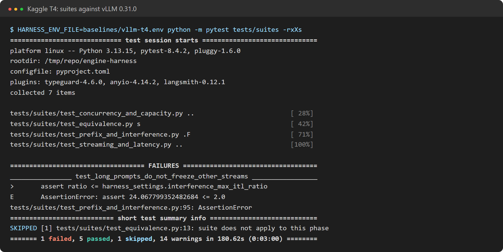

# LLM Inference Engine from Scratch (Qwen3 + PyTorch)

[](./LICENSE)

**You want to serve a small LLM yourself.** Qwen3-0.6B fits on a free T4 GPU, so you write the
obvious loop: take the prompt, run the model, pick the next token, append it, run the model again.
One user gets 28 tokens a second, and that feels fine.

Then, one by one, things break:

- **Answers get slower the longer they get.** Every new token runs the *whole* text through the
  model again: a step takes 35 ms at 16 tokens and 102 ms at 1,024.
- **You cache the work you already did** (the KV cache), so each step only computes one new token.
  But the server still answers one user at a time, and the 64th user waits for the other 63.
- **You batch users into one step.** Now each user reserves memory for the longest possible
  answer, so only 18 fit on the GPU, even though most answers are short.
- **You hand out memory in small blocks instead.** 64 users fit, but one user pasting a
  1,000-token document freezes everyone else's stream while it's read, and 64 users with the same
  system prompt each compute it again.
- **A single user is still slow**, because the GPU spends most of each step waiting for Python to
  launch about 1,800 tiny operations, one by one.

Each step raises the next question: what to cache, who runs in the next step, where memory goes,
and what the GPU is really waiting on. This project answers them one at a time in one engine,
`nanoengine`, and measures every answer against real **vLLM** on the same GPU. The result is an
OpenAI-compatible server with a KV cache, continuous batching, a paged KV cache, prefix caching,
chunked prefill, speculative decoding, CUDA graphs and int8, written in plain PyTorch, each switched
on by one setting.

For example, Asha asks *"Capital of India?"* with `stream: true`. Her prompt joins the next step
next to 40 other users. The engine finds free 16-token blocks for it, reuses the cached blocks of
the system prompt everyone shares, and computes only the rest. Then every step adds one token for
all 41 users at once, and each new word reaches her as its own `data:` line. If another user
pastes a 1,000-token document meanwhile, it is read in chunks between those steps, so her stream
keeps moving.

<p align="center">
  
</p>

**Every claim here is measured.** One test harness sends the same streaming requests to every
phase and to vLLM 0.31.0 on a Kaggle T4, and timestamps every token. The numbers below come from
those runs ([docs/results/](docs/results/)).

---

## How it works

A request passes five stages. Each one exists because the simpler version broke:

- **API (FastAPI):** `POST /v1/completions` takes text or token IDs, checks the length, and hands
  the request to the engine loop. Tokens come back as Server-Sent Events, one per token.
- **Engine loop and scheduler:** one background loop runs the model step after step. Before each
  step the scheduler picks who runs: new prompts get a seat as soon as there is one, finished
  answers leave at once, and long prompts are cut into chunks so they share each step with
  everyone else's next token.
- **KV memory manager:** the cache is one flat pool of token slots. Each user gets 16-token blocks
  only as their text grows. Blocks with the same prompt start are shared between users, and when
  memory runs out the newest user is paused and recomputed later.
- **Model runner:** packs every user's new tokens into one padded batch, tells attention which
  slots to write and read, runs Qwen3, and samples one token per user. Small decode steps are
  replayed as a recorded CUDA graph: one launch instead of about 1,800.
- **Qwen3 in plain PyTorch:** 28 layers with the same parameter names as the Hugging Face
  checkpoint, so the real weights load straight in. Weights can be stored as int8.

Every optimization is a setting (`NANOENGINE_KV_CACHE=paged`, `NANOENGINE_SCHEDULER=continuous`,
...). Old values stay as baselines, so any phase can be re-run on the same code. A profile in
[`nanoengine/profiles/`](nanoengine/profiles/) sets the modes for one phase.

---

## Concepts used

| Concept | In plain words |
|---|---|
| **Prefill and decode** | Reading the prompt (many tokens in one pass) is a different job from writing the answer (one token per pass). Most serving tricks treat them differently. |
| **KV cache** | Each layer keeps the keys and values of tokens it has already seen, so a new token is computed alone instead of the whole text again. |
| **Continuous batching** | The batch is rebuilt every step: finished users leave, new ones join, nobody waits for the slowest answer in their batch. Static batching is kept to show the difference. |
| **Paged KV cache** | Memory is handed out in 16-token blocks as text grows, like pages in an OS. A block table maps each position to its block (vLLM's PagedAttention idea). |
| **Preemption** | When blocks run out, the newest user gives theirs back and is recomputed later, instead of the server failing. |
| **Prefix caching** | Full blocks are keyed by their tokens plus everything before them, so users with the same prompt start share the same blocks. Unused cached blocks are evicted least recently used first. |
| **Chunked prefill** | Each step has a token budget. Long prompts are split into chunks that share it with every user's next token, so a pasted document can't freeze other streams. |
| **Speculative decoding** | Something cheap guesses the next few tokens (a repeated n-gram from the prompt, or a smaller model). The big model checks all guesses in one pass and keeps the right ones, with output identical in distribution. |
| **CUDA graphs** | A whole decode step is recorded once on the GPU and replayed with one launch, per (batch size, context length) bucket. |
| **int8 weights and KV cache** | Numbers are stored in 1 byte plus a scale per row or per head, so the same memory holds about twice as many tokens. |
| **TTFT and ITL** | Time to first token and inter-token latency: what a user actually feels. The harness measures both at p50 and p99. |

---

## What I measured

All on one Kaggle T4, Qwen3-0.6B in fp16, the `t4` workload scale.

### 1. Every phase against vLLM

`short_chat`: 64 tokens in, 128 out, with 1 to 64 users sending requests back to back.

<p align="center"></p>

| Engine | 1 user, tok/s | 64 users, tok/s | Users that fit in KV memory |
|---|---|---|---|
| Phase 1: naive | 28.3 | one at a time | 1 |
| Phase 2: KV cache | 27.3 | one at a time | 1 |
| Phase 3: continuous batching | 26.0 | 394 | 18 |
| Phase 4: paged KV cache | 26.7 | **1,028** | **64** |
| Phase 5: + prefix cache, chunked prefill | 23.4 | 602 | 64 |
| Phase 6: n-gram speculation | 50.0 | one at a time | 1 |
| Phase 7: + CUDA graphs | **70.2** | 617 | 64 |
| Phase 7: + int8 weights and KV cache | 27.3 | 433 | 64, in half the memory |
| vLLM 0.31.0 | 142.6 | 1,928 | 64 |

- **One user:** 49% of vLLM's speed, up from 20%. CUDA graphs did most of it.
- **64 users:** 53% of vLLM's throughput (phase 4). The rest is kernels: vLLM's attention reads KV
  blocks where they are, while this engine copies each user's cache into a padded tensor every step.
- **Phase 5 is slower than phase 4 at 64 users** (602 against 1,028 tok/s), though it wins on
  shared and long prompts (section 4). Which of its two features costs the throughput isn't
  measured yet: the next step is a run with each one on its own.

### 2. The KV cache: a step stops growing with length

<p align="center"></p>

- **Without a cache** a step grows from 35 ms to 102 ms between 16 and 1,024 tokens.
- **With a cache** it stays at about 33 ms. For 1,024-token prompts, throughput went from 9.2 to
  25.7 tok/s.
- **A one-line trap:** writing to the cache with a boolean mask made the GPU stop and report a
  count once per layer. Sending padding to a spare scratch slot instead took a step from 47 to
  33 ms.
- **CUDA graphs** take it to 13.3 ms: most of a small model's step was launch overhead.

### 3. Batching: continuous against static

`mixed_lengths` (answers from 16 to 512 tokens) with 16 users:

<p align="center"></p>

| `mixed_lengths`, 16 users | Static batching | Continuous batching |
|---|---|---|
| Total tok/s | 202 | **285** |
| Time to first token, p50 | 6.9 s | **0.085 s** |

- **A static batch runs until its longest answer ends.** Seats freed by short answers stay empty,
  and new users wait outside the whole time.
- **Paged memory** then let 64 users fit instead of 18, because nobody reserves memory for a
  2,048-token answer up front. On this workload at 64 users that doubled throughput (about 300 →
  595 tok/s); on `short_chat` it went from 394 to 1,028.

### 4. Shared prompts and long prompts

- **Prefix caching:** with 512 of 544 prompt tokens shared, time to first token dropped from 141 to
  **46 ms (−67%)**. Over the run, 262,864 prompt tokens came from the cache instead of being
  computed. vLLM: 86 → 23 ms.
- **Chunked prefill:** while 1,024-token prompts arrive, other users' p99 inter-token latency rises
  2.3× (phase 4: 3.2×). The harness asks for 2×, so this still fails, but vLLM fails it too: 24×.

### 5. Speculative decoding: guesses only pay when they're cheap

<p align="center"></p>

- **N-gram guesses** (look for the last few tokens earlier in the text, guess what followed):
  **3.05×** on a code edit, where the answer copies the prompt, and 1.82× on chat.
- **A small draft model** (0.6B guessing for 1.7B) made it **slower** (0.88× and 0.63×), even with
  84% of guesses accepted. Each guess is one more small step, and small steps are mostly launch
  overhead here.

### 6. int8: half the memory, almost no quality cost, but slower

| | fp16 | int8 weights + int8 KV |
|---|---|---|
| Perplexity on a fixed text | 66.676 | 66.699 (+0.03%) |
| KV tokens in the same 4 GB | 37,440 | **73,744 (1.97×)** |
| One user, tok/s | 70.2 | 27.3 |

Plain PyTorch has to turn each int8 weight back into fp16 before every matmul, so int8 saves
memory here, not time. Fast int8 needs kernels that multiply int8 directly.

Each phase's full write-up, with what failed along the way, is in [docs/phases/](docs/phases/).

---

## How it's tested

The harness never imports the engine. It talks HTTP to a URL, so the same suites run against any
phase and against vLLM. A settings file per phase and device lists which suites it should fail, so
an expected failure shows up as `XFAIL`, not red.

| Suite | Traffic | Passes when |
|---|---|---|
| `equivalence` | 10 prompts, greedy | output tokens match the phase 1 reference exactly |
| `streaming` | one streaming request | one chunk per token, the right count, then `[DONE]` |
| `latency` | `short_chat`, one user | TTFT and ITL are measured with no errors |
| `concurrency` | `short_chat` at 1 → 64 users | total throughput grows at least 4× (T4) |
| `capacity` | `burst`: 64 requests at once | no errors, nothing dropped |
| `prefix_reuse` | `shared_prefix`: 512 shared tokens | TTFT at least 50% lower than with unique prompts |
| `long_prompt_interference` | `short_chat` while 1,024-token prompts arrive | other users' p99 ITL rises less than 2× |

Prompts are sent as token IDs, so every engine sees exactly the same token counts. The harness
uses aiohttp, which keeps 64 streams in flight from one process.

Unit tests: 106 in `nanoengine` (about 98% coverage, 80% enforced) and 37 in the harness, which
checks its timing math against a stub engine with known delays. Every full-precision mode is tested
to give exactly the same greedy tokens as running each request alone with no cache. One opt-in test
compares logits against the real Qwen3-0.6B weights (`NANOENGINE_TEST_REAL_WEIGHTS=1`).

<p align="center"></p>

---

## Run it locally

### Prerequisites

- Python 3.11+. A GPU is optional: everything runs on CPU, just slower.
- Windows PowerShell commands below; on macOS/Linux use `.venv/bin/python` instead of
  `.\.venv\Scripts\python.exe`.

### Start the engine

```powershell
cd inference-engine-from-scratch\nanoengine
python -m venv .venv
.\.venv\Scripts\python.exe -m pip install torch --index-url https://download.pytorch.org/whl/cpu
.\.venv\Scripts\python.exe -m pip install -e ".[dev]"
.\.venv\Scripts\python.exe -m pytest                       # unit tests

$env:NANOENGINE_ENV_FILE="profiles/phase-04-paged.env"     # pick a phase
.\.venv\Scripts\python.exe -m nanoengine                   # downloads Qwen3-0.6B once, serves :8000
```

### Send a request

```powershell
curl.exe -N http://localhost:8000/v1/completions -H "Content-Type: application/json" `
  -d '{\"model\": \"Qwen/Qwen3-0.6B\", \"prompt\": \"Capital of India?\", \"max_tokens\": 32, \"stream\": true}'
```

Also available: `GET /v1/models`, `GET /healthz`, `GET /metrics` (Prometheus), and the API docs at
`http://localhost:8000/docs`.

### Run the harness against it

In a second terminal:

```powershell
cd inference-engine-from-scratch\engine-harness
python -m venv .venv
.\.venv\Scripts\python.exe -m pip install -e ".[dev]"
.\.venv\Scripts\python.exe -m pytest                       # harness unit tests

$env:HARNESS_ENV_FILE="expectations/phase-04-paged-cpu.env"
.\.venv\Scripts\python.exe -m pytest tests/suites -rxXs    # suites against the running engine
.\.venv\Scripts\python.exe -m engineharness sweep short_chat
```

### On a free Kaggle T4

Put a Kaggle API token in `.env` as `KAGGLE_API_TOKEN` (the file is gitignored), push your commits
(the notebook clones the repo), then:

```powershell
python scripts/kaggle/run_on_kaggle.py phase-04-paged --owner <kaggle-user>
python scripts/kaggle/run_on_kaggle.py vllm --owner <kaggle-user>
```

Results land in `docs/results/<target>-t4/`.

### Clean up

Stop the engine with `Ctrl+C`. The model is cached in the Hugging Face cache
(`~/.cache/huggingface`); delete it there to free about 1.2 GB.

---

## Project structure

```text
inference-engine-from-scratch/
├── nanoengine/                     the engine (one package, a mode flag per optimization)
│   ├── src/nanoengine/
│   │   ├── api/                    FastAPI routes, request and response schemas, SSE streaming
│   │   ├── engine/
│   │   │   ├── scheduling/         engine loops (serial, batched) and the batch schedulers
│   │   │   ├── memory/             KV cache pool, contiguous / paged allocators, prefix cache
│   │   │   ├── generation/         model runner, batch builder, CUDA graphs, naive / cached generators
│   │   │   ├── speculative/        n-gram and draft proposers, verifier
│   │   │   └── runtime.py, sampling.py, sequence_state.py, interface.py, metrics.py
│   │   ├── models/                 Qwen3 in PyTorch, cached attention, int8, weight loader, tokenizer
│   │   ├── benchmarks/             step timing, int8 quality, speculative speed-up
│   │   └── app.py, config.py, constants.py, __main__.py
│   ├── profiles/                   one .env per phase
│   └── tests/                      mirrors the package
├── engine-harness/                 HTTP load generator + pytest suites, works on any OpenAI-style server
│   ├── src/engineharness/          workloads, streaming client, latency metrics, sweeps, reports
│   ├── tests/{unit,suites}/
│   ├── expectations/               what each phase (and vLLM) should pass, per device
│   └── reference/                  phase 1's greedy outputs, the correctness reference
├── scripts/                        Kaggle runner, progress charts, terminal screenshots
└── docs/
    ├── phases/                     one write-up per phase
    ├── results/                    harness reports per phase and device
    └── images/
```

Code at the end of each phase: `git checkout phase-NN`. A file-by-file walkthrough, following one
request through the engine, is in the companion notes.

---

## License

[MIT](./LICENSE)
