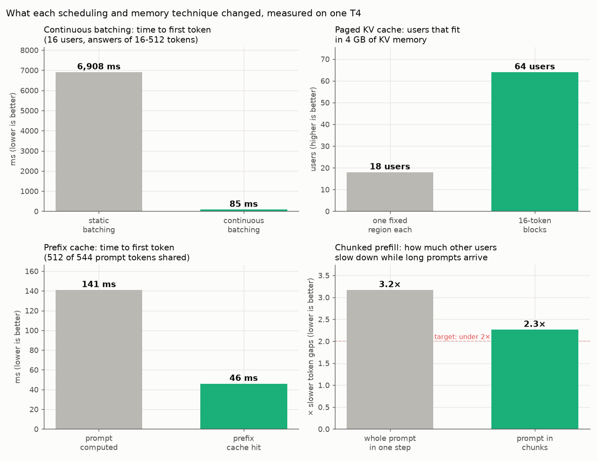

# LLM Inference Engine from Scratch (Qwen3 + PyTorch)

[](./LICENSE)

**Serving an LLM to many users at once is a scheduling and memory problem, not a model problem.** This project builds the server that solves it: an OpenAI-compatible inference engine for **Qwen3-0.6B** in plain PyTorch. It adds the techniques production engines like vLLM and SGLang use, one at a time, and **measures each one against vLLM on the same GPU** (a Kaggle T4).

**Implemented from scratch, each one measured on a T4:**

| Technique | What it does | Measured result |
|---|---|---|
| **Qwen3 model in PyTorch** | own ~200-line implementation of the model | logits match Hugging Face `transformers` exactly |
| **KV cache** | keeps past keys/values so each token is computed once | decode step flat at 33 ms (was 102 ms at 1,024 tokens) |
| **Continuous batching** | users join and leave the batch every step | first token 6.9 s → **0.085 s** (16 users) |
| **Paged KV cache** | memory in 16-token blocks, given out as text grows | **64 users fit instead of 18**; 1,028 tok/s at 64 users |
| **Prefix caching** | users with the same prompt start share cached blocks | first token 141 → **46 ms** |
| **Chunked prefill** | long prompts read in pieces, so others keep streaming | others' slowdown 3.2× → 2.3× |
| **Preemption** | pauses the newest user when memory runs out, recomputes later | no failures at 64 users at once |
| **Speculative decoding** | cheap guesses checked by the model in one pass | **3.05×** faster for one user (n-gram) |
| **CUDA graphs** | replays a whole decode step with one GPU launch | one user 28 → **70 tok/s** |
| **int8 weights + KV cache** | 1 byte per number instead of 2 | **1.97×** the tokens at +0.03% perplexity |

- **Against vLLM** on the same GPU: 53% of its throughput at 64 users, 49% at 1 user

<p align="center"></p>

---

## How it works

<p align="center">
  
</p>

- **API (FastAPI):** `POST /v1/completions` takes text or token IDs; tokens stream back as Server-Sent Events, one per token
- **Engine loop + scheduler:** one background loop runs the model step after step. Before each step it picks who runs:
  - new prompts join as soon as there's a seat, finished answers leave at once (**continuous batching**)
  - long prompts are cut into chunks that share each step with everyone else (**chunked prefill**)
  - when memory runs out, the newest user is paused and recomputed later (**preemption**)
- **KV memory manager:** keys and values of every token, in one pool of GPU memory
  - each user gets 16-token blocks only as their text grows (**paged KV cache**)
  - users with the same prompt start share blocks (**prefix cache**)
- **Model runner:** packs all users' new tokens into one batch, runs Qwen3, samples one token each. Small decode steps replay a recorded **CUDA graph**: one launch instead of ~1,800
- **Qwen3 in PyTorch:** 28 layers with Hugging Face's parameter names, so the real weights load directly; optional **int8** weights
- **Every optimization is a setting** (`NANOENGINE_KV_CACHE=paged`, …), so every phase still runs on today's code

---

## Results (one Kaggle T4, Qwen3-0.6B, fp16)

### 1. Throughput: every phase against vLLM

`short_chat` workload: 64 tokens in, 128 out. Total tokens/s across all users.

<p align="center"></p>

- **Batching + paged memory** took 64 users from one-at-a-time to **1,028 tok/s**
- **CUDA graphs** took one user from 28 to **69 tok/s**
- **The gap to vLLM** is mostly kernels: vLLM's attention reads KV blocks in place and fuses operations; this engine copies each user's cache into a padded tensor every step, in plain PyTorch

### 2. KV cache and CUDA graphs: time per decode step

<p align="center"></p>

- **No cache:** each step recomputes the whole text: 102 ms at 1,024 tokens
- **KV cache:** flat ~33 ms at any length
- **CUDA graph:** ~13 ms. a graph replays a step's ~1,800 GPU operations with one launch

### 3. Scheduling and memory: before vs after each technique

<p align="center"></p>

- **Continuous batching:** a static batch runs until its longest answer ends, so newcomers wait outside
- **Paged KV cache:** nobody reserves memory for a 2,048-token answer up front
- **Prefix cache:** vLLM reaches 23 ms here
- **Chunked prefill:** still above the 2× target; vLLM itself slows others **24×** on this test

### 4. Speculative decoding: cheap guesses pay, a draft model didn't

<p align="center"></p>

- **Idea:** something cheap guesses the next few tokens; the model checks all guesses in one pass
- **Grey** = no speculation, **green** = faster, **red** = slower; "guesses accepted" = how often a guess was right
- **n-gram guesses** (free: reuse what followed the same words earlier): **3.05×** on code edits, which copy the prompt; 1.82× on chat
- **A draft model was slower**, even with 84% right: each guess is one more small model step, and small steps here are mostly launch overhead
- **Lesson:** speculation pays only when guessing is nearly free

### 5. int8: half the memory, almost no quality cost

| | fp16 | int8 weights + KV |
|---|---|---|
| Perplexity on a fixed text | 66.676 | 66.699 (+0.03%) |
| KV tokens in the same 4 GB | 37,440 | **73,744 (1.97×)** |
| One user, tok/s | ~70 | 27 |

- Slower here because plain PyTorch converts each int8 weight back to fp16 before every matmul; fast int8 needs fused kernels

---

## How it's tested

A separate **test harness** sends real HTTP requests, so the exact same tests run on every phase and on vLLM. It never imports the engine's code.

**Passed by every phase and by vLLM:**
- **Streaming:** one SSE chunk per token, then `[DONE]`
- **Latency:** time to first token and token gaps measured with no errors
- **Capacity:** 64 requests at the same moment, 0 errors
- **Correctness:** every full-precision phase gives exactly the same greedy text as phase 1 (on CPU)

**The three tests that tell the phases apart** (✅ passes the target · ❌ misses it · ➖ that phase doesn't have the feature yet):

| Engine | Scales with users<br>(64 users vs 1, target ≥ 4×) | Shared prompt is faster<br>(first token, target ≥ 50% faster) | Long prompts don't slow others<br>(target < 2× slower) |
|---|---|---|---|
| 1–2: no batching | ➖ one user at a time | ➖ | ➖ |
| 3: static batching | ✅ 15× | ➖ | ✅ 0.9× (admits no one mid-batch) |
| 3: continuous batching | ✅ 15× | ➖ | ❌ 3.4× |
| 4: paged KV cache | ✅ **40×** | ➖ | ❌ 3.2× |
| 5: + prefix cache, chunked prefill | ✅ 26× | ✅ 67% faster | ❌ 2.3× |
| 7: + CUDA graphs | ✅ 9× (1 user already faster) | ✅ 66% faster | ❌ 5.1× |
| 7: + int8 | ✅ 16× | ✅ 68% faster | ❌ 3.5× |
| vLLM 0.31.0 | ✅ 14× | ✅ 73% faster | ❌ 24× |

---

## Run it locally

**Prerequisites:** Python 3.11+. A GPU is optional (everything runs on CPU, slower). Commands are PowerShell; on macOS/Linux use `.venv/bin/python`.

```powershell
# 1. the engine
cd inference-engine-from-scratch\nanoengine
python -m venv .venv
.\.venv\Scripts\python.exe -m pip install torch --index-url https://download.pytorch.org/whl/cpu
.\.venv\Scripts\python.exe -m pip install -e ".[dev]"
.\.venv\Scripts\python.exe -m pytest                       # unit tests
$env:NANOENGINE_ENV_FILE="profiles/phase-04-paged.env"     # pick a phase
.\.venv\Scripts\python.exe -m nanoengine                   # downloads Qwen3-0.6B once, serves :8000

# 2. a request (second terminal)
curl.exe -N http://localhost:8000/v1/completions -H "Content-Type: application/json" `
  -d '{\"model\": \"Qwen/Qwen3-0.6B\", \"prompt\": \"Capital of India?\", \"max_tokens\": 32, \"stream\": true}'

# 3. the harness against it
cd inference-engine-from-scratch\engine-harness
python -m venv .venv
.\.venv\Scripts\python.exe -m pip install -e ".[dev]"
$env:HARNESS_ENV_FILE="expectations/phase-04-paged-cpu.env"
.\.venv\Scripts\python.exe -m pytest tests/suites -rxXs
.\.venv\Scripts\python.exe -m engineharness sweep short_chat
```

- Other endpoints: `GET /v1/models`, `GET /healthz`, `GET /metrics` (Prometheus), API docs at `http://localhost:8000/docs`
- **On a free Kaggle T4:** put `KAGGLE_API_TOKEN` in `.env` (gitignored), push your commits, then `python scripts/kaggle/run_on_kaggle.py phase-04-paged --owner <kaggle-user>` (or `vllm`). Results land in `docs/results/<target>-t4/`

---

## Project structure

```text
inference-engine-from-scratch/
├── nanoengine/                 the engine: one package, a setting per optimization
│   ├── src/nanoengine/
│   │   ├── api/                FastAPI routes, schemas, SSE streaming
│   │   ├── engine/
│   │   │   ├── scheduling/     engine loops and batch schedulers
│   │   │   ├── memory/         KV cache pool, paged allocator, prefix cache
│   │   │   ├── generation/     model runner, batch builder, CUDA graphs
│   │   │   ├── speculative/    n-gram and draft proposers, verifier
│   │   │   └── runtime.py      builds the engine from the settings
│   │   ├── models/             Qwen3, cached attention, int8, weight loader, tokenizer
│   │   └── benchmarks/         step timing, int8 quality, speculative speed-up
│   ├── profiles/               one .env per phase
│   └── tests/
├── engine-harness/             HTTP load generator + pytest suites for any OpenAI-style server
├── scripts/                    Kaggle runner, charts, screenshots
└── docs/                       phase write-ups, results per phase and device, images
```

---

## Phases

Each phase adds one technique; the write-up covers what changed, the results and what went wrong.

| Phase | Technique | Fixes | Write-up |
|---|---|---|---|
| 1 | own Qwen3, naive loop | baseline: recomputes the whole text every token | [phase 1](docs/phases/phase-01-naive.md) |
| 2 | KV cache | step time grew with text length | [phase 2](docs/phases/phase-02-kv-cache.md) |
| 3 | static and continuous batching | one user at a time wastes the GPU | [phase 3](docs/phases/phase-03-batching.md) |
| 4 | paged KV cache | memory reserved for the longest possible answer | [phase 4](docs/phases/phase-04-paged.md) |
| 5 | prefix cache, chunked prefill | repeated system prompts; long prompts freezing others | [phase 5](docs/phases/phase-05-prefix-chunked.md) |
| 6 | speculative decoding (n-gram, draft model) | one token per model pass | [phase 6](docs/phases/phase-06-speculative.md) |
| 7 | CUDA graphs, int8 weights and KV cache | Python launch overhead; KV memory | [phase 7](docs/phases/phase-07-int8-cuda-graphs.md) |

