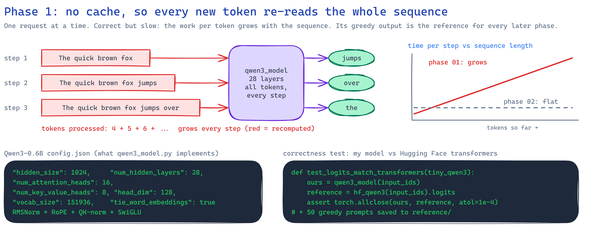
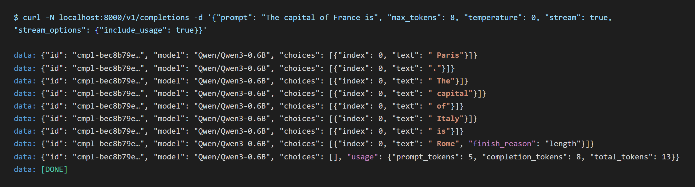
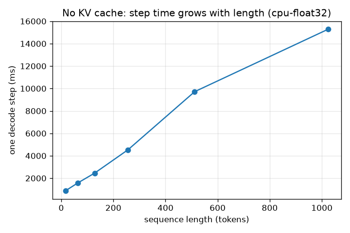
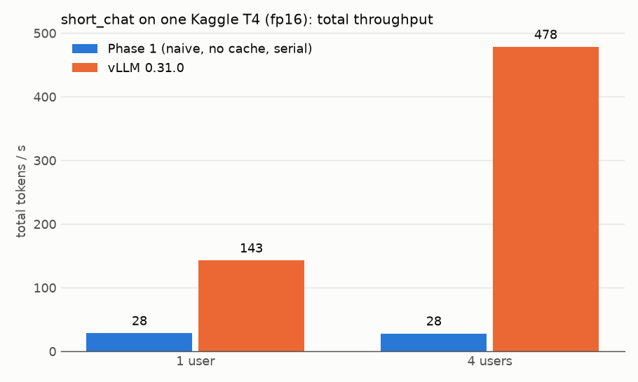
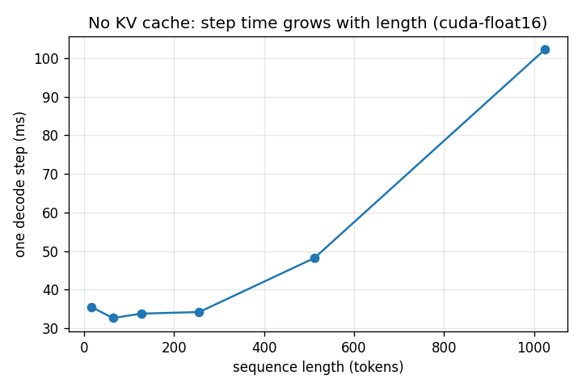
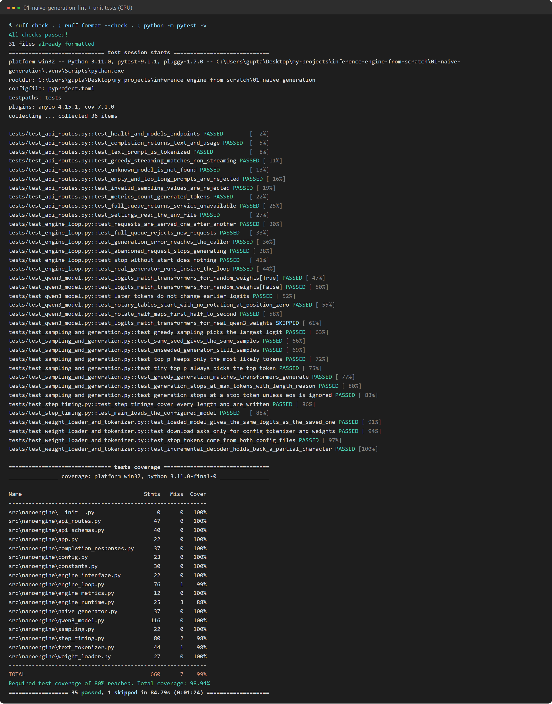
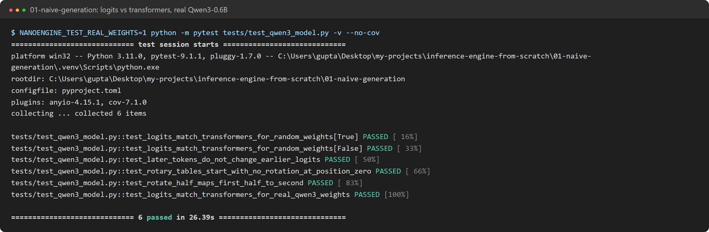
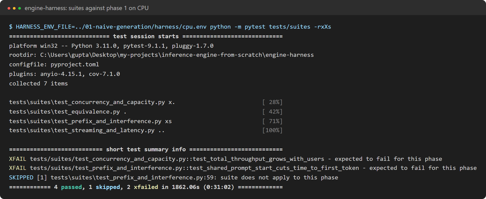
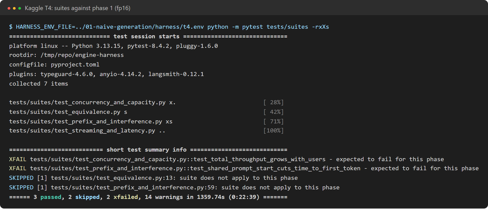

# Phase 1: naive generation

Qwen3-0.6B in plain PyTorch, served over the standard OpenAI-style API. There is **no KV cache**:
every new token runs the whole sequence through the model again. There is no batching: requests
are served one at a time, and the rest wait in a queue. Every later phase is checked against the
greedy outputs of this phase.



## What is inside

Modules added in this phase (paths under `nanoengine/src/nanoengine/`). Code at the end of
this phase: `git checkout phase-01`.

| Module | Job |
|---|---|
| `models/qwen3.py` | Decoder: embeddings, RMSNorm, RoPE, grouped-query attention with QK-norm, SwiGLU MLP, tied output head. Uses the checkpoint's parameter names |
| `models/weight_loader.py` | Downloads config, tokenizer and safetensors with `huggingface_hub`, then loads them onto the meta-built model |
| `models/text_tokenizer.py` | Encode and decode, stop tokens from the configs, incremental decoding that never splits a UTF-8 character |
| `engine/sampling.py` | Greedy, temperature and top-p, with a seeded generator per request |
| `engine/naive_generator.py` (`kv_cache=none`) | The no-cache loop: forward the full sequence, sample, append, repeat |
| `engine/engine_loop.py` (`scheduler=serial`) | One background task serves one request at a time. Model steps run in a worker thread so streaming keeps flowing |
| `api/routes.py`, `api/completion_responses.py` | `/v1/completions` (JSON or SSE, token-ID or text prompts, `ignore_eos`, `stream_options.include_usage`), `/v1/models`, `/healthz`, `/metrics` |
| `step_timing.py` | Measures one step's time at growing sequence lengths |

## Correctness

- Logits match Hugging Face `transformers` (fp32, CPU) within 1e-4 for random weights, and within
  1e-3 for real Qwen3-0.6B weights with identical argmax. Run the real-weights check with
  `NANOENGINE_TEST_REAL_WEIGHTS=1`.
- Greedy generation gives the same tokens as `transformers` `generate()`.
- Greedy reference outputs for the equivalence suite: `engine-harness/reference/greedy-reference.json`
  (CPU, fp32).

## Results on CPU (i7-1165G7, fp32)

A real streamed response. The engine sends one SSE chunk per token, then a usage chunk, then `[DONE]`:



**Step time grows with sequence length.** Without a KV cache, every new token re-runs the whole
sequence. At 1,024 tokens, one token takes 15 s. Phase 2 caches keys and values to flatten this line.



| Sequence length | 16 | 64 | 128 | 256 | 512 | 1024 |
|---|---|---|---|---|---|---|
| Step time (ms, median) | 873 | 1,584 | 2,452 | 4,533 | 9,718 | 15,284 |

Even at 16 tokens, a step costs about 0.87 s. That cost is mostly reading 0.6B fp32 weights, about
2.4 GB, from memory on every step.

**One request at a time.** Total throughput stays flat as users increase. Extra users only wait
longer in the queue (short_chat, `cpu` scale):

| Users | Total tok/s | TTFT p50 | ITL p50 | E2E p50 |
|---|---|---|---|---|
| 1 | 1.2 | 0.7 s | 772 ms | 25 s |
| 2 | 1.2 | 28.6 s | 830 ms | 56 s |
| 4 | 1.3 | 74.7 s | 775 ms | 99 s |

Harness outcomes ([full report](../results/phase-01-naive-cpu/harness-report.md)): 4 passed, 2 expected failures
(concurrency, prefix reuse), 1 skipped. Equivalence: 10/10 greedy outputs identical to the reference.

## Results on a Kaggle T4 (fp16)

Same engine on a T4 with the `t4` workload scale. Full results:
[docs/results/phase-01-naive-t4](../results/phase-01-naive-t4/results/harness-report.md).
Outcomes match the CPU run: 3 passed, 2 expected failures (equivalence and interference are
skipped on T4).



| short_chat (64 in / 128 out) | Phase 1 | vLLM | vLLM is |
|---|---|---|---|
| Total tok/s, 1 user | 28.3 | 142.6 | 5× faster |
| Total tok/s, 4 users | 27.8 | 478.2 | 17× faster |
| Inter-token latency p50, 1 user | 35.2 ms | 6.9 ms | 5× faster |
| TTFT p50, 4 users | 13.8 s (queued) | 39 ms | 350× faster |

**On the GPU, step time is flat until about 256 tokens.** The work is small, so the fixed cost of
launching hundreds of small kernels per step from Python dominates (about 33 ms). Above 256 tokens
the recomputed attention and matmuls take over, reaching 102 ms at 1,024 tokens.



| Sequence length | 16 | 64 | 128 | 256 | 512 | 1024 |
|---|---|---|---|---|---|---|
| Step time on T4 (ms, median) | 35.5 | 32.6 | 33.8 | 34.2 | 48.2 | 102.2 |
| Step time on CPU (ms, median) | 873 | 1,584 | 2,452 | 4,533 | 9,718 | 15,284 |

What each later phase removes:
- Phase 2 (KV cache) removes the growth past 256 tokens.
- Phase 3 (batching) lets users share each step, instead of queueing (13.8 s TTFT at 4 users).
- Phase 7 (CUDA graphs) removes the 33 ms launch floor.

## Testing

The suite has 36 unit tests (35 passed, 1 skipped) on a tiny random-weight Qwen3, which runs on
CPU in seconds. It covers the API, the engine loop, the model against `transformers`, sampling, the
loader and the tokenizer. Lint is clean and coverage is 99%.



The skipped test runs against real Qwen3-0.6B weights (downloaded once, about 1.2 GB). It checks
that our logits match `transformers`:



The harness suites ran against the running engine, first on a laptop CPU and then on a Kaggle T4:





## Reproduce

Setup: [nanoengine/README.md](../../nanoengine/README.md). The `phase-01-naive` profile selects
`kv_cache=none` and `scheduler=serial`.

```powershell
cd nanoengine
$env:NANOENGINE_ENV_FILE="profiles/phase-01-naive.env"
.\.venv\Scripts\python.exe -m nanoengine
.\.venv\Scripts\python.exe -m nanoengine.step_timing --output-dir ../docs/results/phase-01-naive-cpu

cd ../engine-harness
$env:HARNESS_ENV_FILE="../nanoengine/harness/phase-01-naive-cpu.env"
.\.venv\Scripts\python.exe -m pytest tests/suites -rxXs
```

On a Kaggle T4 (fp16): `python kaggle/run_on_kaggle.py phase-01-naive --owner <kaggle-user>`.

## Expected harness outcomes

| Suite | Outcome | Why |
|---|---|---|
| streaming, latency, capacity, equivalence | pass | |
| concurrency | expected fail | one request at a time, so more users add no throughput |
| prefix_reuse | expected fail | nothing is cached |
| long_prompt_interference | skipped | without batching, a running stream is never interrupted |
