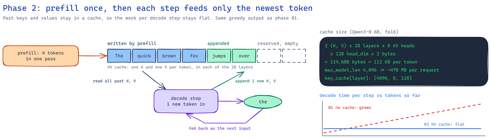
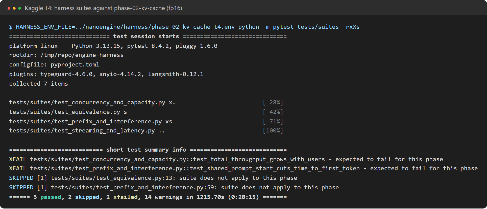
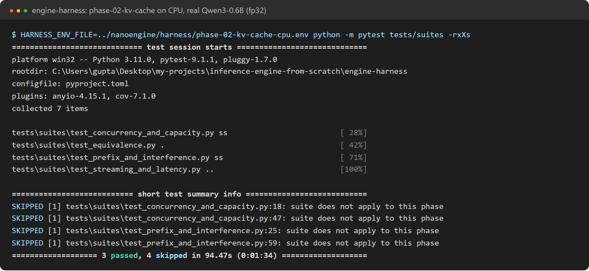

# Phase 2: KV cache

**Profile:** `phase-02-kv-cache` (`kv_cache=contiguous`, `scheduler=serial`).
**Code at the end of this phase:** `git checkout phase-02`.

Phase 1 recomputes every earlier token for each new token. Phase 2 keeps every layer's keys and
values in a cache instead. The prompt is processed once (prefill), then each step feeds only the
newest token, which reads the cached keys and values (decode).

## What changed

| Module | Job |
|---|---|
| `models/attention_context.py` | Cached attention. The KV cache is one flat pool of token slots per layer. A step writes its new keys and values into their slots, then reads each sequence's context through its slot list |
| `engine/memory/kv_cache_pool.py` | The pool, sized from a memory budget. One spare scratch slot takes padded tokens |
| `engine/memory/contiguous_allocator.py` | Reserves a `max_model_len` region per sequence |
| `engine/generation/model_runner.py`, `batch_builder.py` | Packs the uncached tokens of the step's sequences into one padded call and samples |
| `engine/generation/cached_generator.py` | The serial loop: one prefill, then one decode step per token |

**KV cache size:** 2 (key and value) × 28 layers × 8 KV heads × 128 dims × 2 bytes =
**114,688 bytes per token** for Qwen3-0.6B in fp16. A 4 GB budget holds 37,449 tokens, and the
pool sizes in phases 3 and 4 match this formula exactly.

## Results on a Kaggle T4 (fp16)

**Decode step time no longer grows with length.** It is flat at about 33 ms, against phase 1's
102 ms at 1,024 tokens. The plan's criterion (512 tokens within 20% of 16 tokens) is met.

| One user | Phase 1 (no cache) | Phase 2 (KV cache) | |
|---|---|---|---|
| long_prompt (1,024 in, 32 out): tok/s | 9.2 | **25.7** | 2.8x |
| long_prompt: inter-token latency p50 | 108.5 ms | **36.1 ms** | 3.0x lower |
| shared_prefix (544 in, 64 out): tok/s | 16.9 | **27.2** | 1.6x |
| short_chat (64 in, 128 out): tok/s | 28.3 | 27.3 | the same |

**Why short prompts gain nothing:** on a T4 a short sequence is not limited by attention math.
The fixed cost of launching about 500 small kernels from Python takes about 33 ms per step. The
cache removes the work that grows with length, so it helps long contexts, not short ones. Phase 7's
CUDA graphs target that fixed cost.

### A measured mistake: one CPU–GPU stall per layer

The first T4 run of phase 2 was slower than phase 1: 47 ms per step, 20.6 tok/s. The cause was
writing new keys and values with boolean-mask indexing (`cache[slots[mask]] = keys[mask]`). On a
GPU this makes the CPU wait for the GPU to report how many elements the mask selects, three times
per layer, so the queue of launched work drained 84 times per step. Padded tokens now write to a
spare scratch slot with `index_copy_`, and no step waits.

| Phase 2 on a T4 | Before the fix | After |
|---|---|---|
| Decode step | 47 ms | 33 ms |
| short_chat, one user | 20.6 tok/s | 27.3 tok/s |

## Correctness

- **Unit tests:** cached decode logits match a full recompute within 1e-5. Greedy output of the
  cached generator equals the naive generator's.
- **Real Qwen3-0.6B on CPU (fp32):** the equivalence suite gives 10/10 outputs identical to phase 1.

Full results: [T4](../results/phase-02-kv-cache-t4/results/harness-report.md) ·
[T4 before the fix](../results/archive/phase-02-kv-cache-t4-before-sync-fix/results/harness-report.md) ·
[CPU](../results/phase-02-kv-cache-cpu/harness-report.md).
