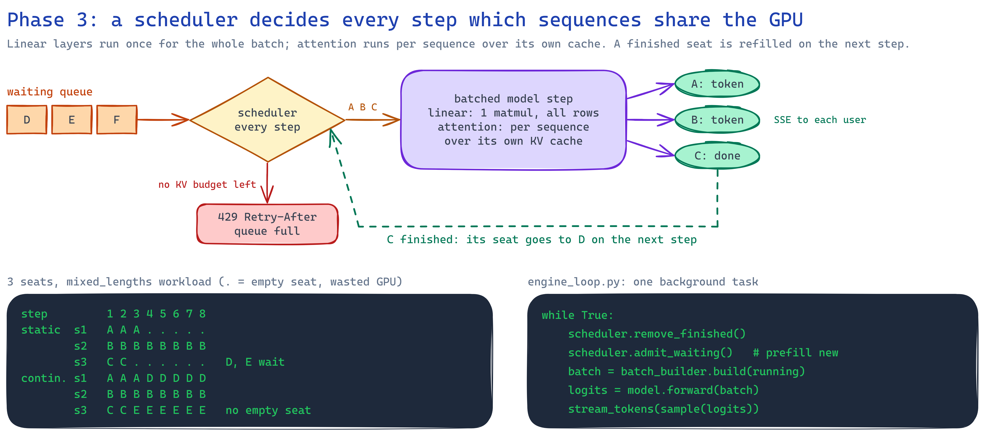
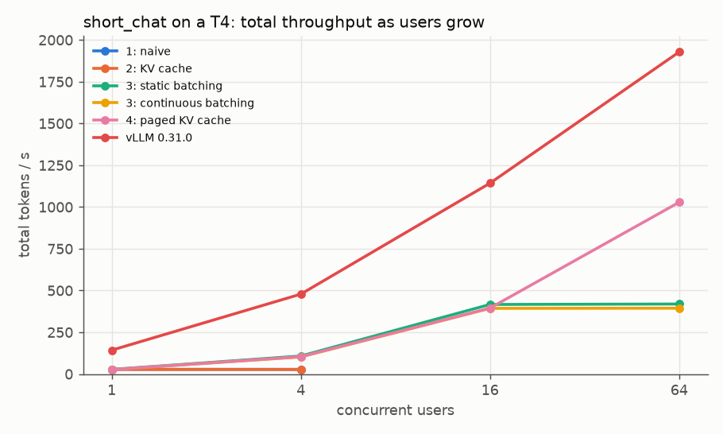
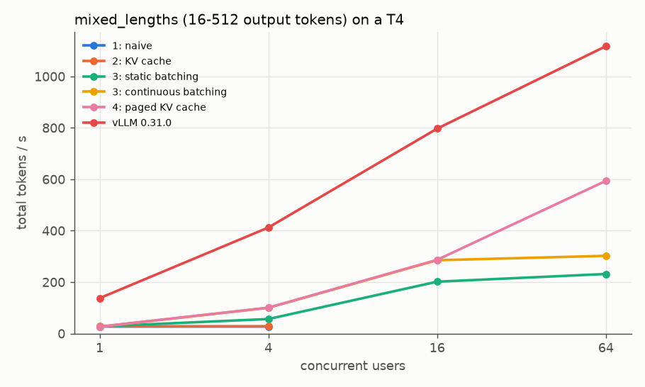
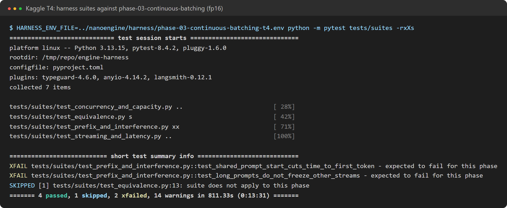
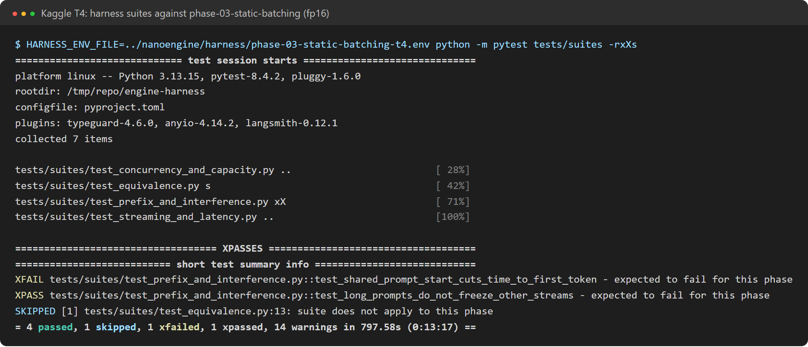
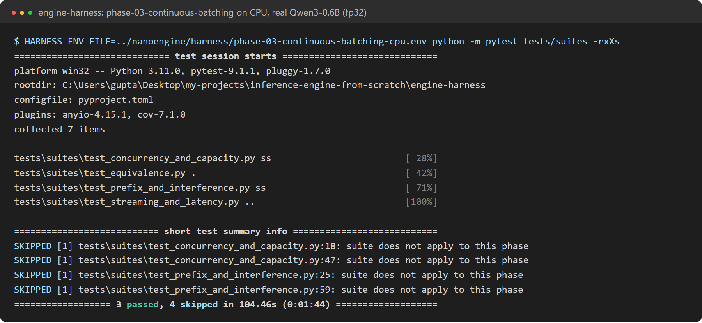

# Phase 3: static and continuous batching

**Profiles:** `phase-03-static-batching` and `phase-03-continuous-batching` (`kv_cache=contiguous`,
`scheduler=static|continuous`, 4 GB KV budget, `max_model_len=2048`).
**Code at the end of this phase:** `git checkout phase-03`.

One background loop now serves many requests. Each step runs one model call for a whole batch of
sequences, so the weights are read once for all of them.
- **Static batching** admits a batch and runs it until every sequence in it is done. Finished seats
  stay empty.
- **Continuous batching** decides again every step. Finished sequences leave and waiting ones join
  at once.

## What changed

| Module | Job |
|---|---|
| `engine/scheduling/batch_engine_loop.py` | The step loop: drop cancelled requests, ask the scheduler, run one step in a worker thread, stream every sequence's new token |
| `engine/scheduling/batch_scheduler.py` | `StaticBatchScheduler` (with a fill timeout) and `ContinuousBatchScheduler`. New arrivals are prefilled first, then everyone decodes. A prefill token budget applies |
| `engine/scheduling/request_queue.py` | Request handles and token streams, shared with the serial loop |
| `api/routes.py` | A full waiting queue answers `429` with `Retry-After` |

The batch is padded to its longest member. Every request's tokens are tested to be identical to
generating it alone, in every mode.

## Results on a Kaggle T4 (fp16)

**Batching multiplies throughput.** At 16 users, continuous batching serves 393 tok/s, against 27
tok/s for the serial phase 2.

**Static vs continuous is about answer lengths.** When every answer has the same length, static
batching wastes nothing and is slightly faster, because there is less scheduling per step. When
lengths vary, static batching keeps finished seats empty until the longest answer ends, and
newcomers wait seconds.

| Contiguous KV cache, T4 | Static | Continuous |
|---|---|---|
| short_chat (all 128 tokens), 64 users: tok/s | **419** | 394 |
| mixed_lengths (16–512 tokens), 16 users: tok/s | 202 | **285** |
| mixed_lengths, 16 users: time to first token p50 | 6.9 s | **0.085 s** |
| mixed_lengths, 64 users: end-to-end p50 | 35.6 s | **29.0 s** |

The plan's criterion (continuous beats static on finish time for `mixed_lengths`) is met. The
plan's other target, 3x phase 2's throughput at 32 users, is met with room to spare: 393 vs 27 tok/s
at 16 users.

**The limit is memory, not compute.** Each sequence reserves a 2,048-token region, while a chat
uses about 192 tokens. So only **18 sequences fit** in the 4 GB budget (peak running = 18), and
throughput stops growing after 16 users. At 64 users, 46 requests wait in the queue
(time to first token 5.4 s). Phase 4 fixes this.

Static batching passes the long-prompt interference check by accident: long prompts wait for the
next batch instead of interrupting running streams. They pay with their own wait.

## Correctness

- **Unit tests:** every scheduler and cache combination gives each request exactly the tokens it
  gets alone.
- **Real Qwen3-0.6B on CPU (fp32):** the equivalence suite gives 10/10 identical outputs for both
  schedulers.

Full results: [static T4](../results/phase-03-static-batching-t4/results/harness-report.md) ·
[continuous T4](../results/phase-03-continuous-batching-t4/results/harness-report.md) ·
[before the sync fix](../results/phase-03-continuous-batching-t4-before-sync-fix/results/harness-report.md).
