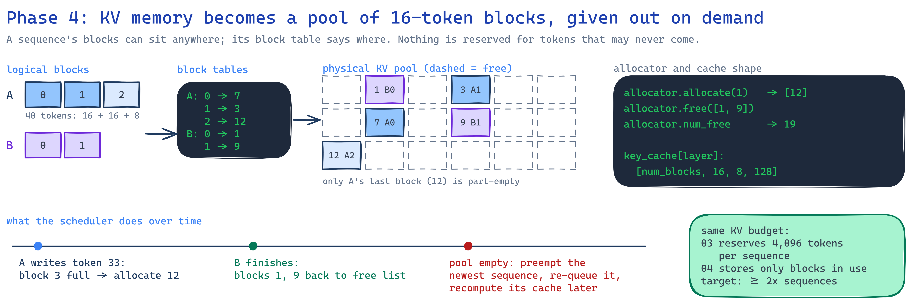
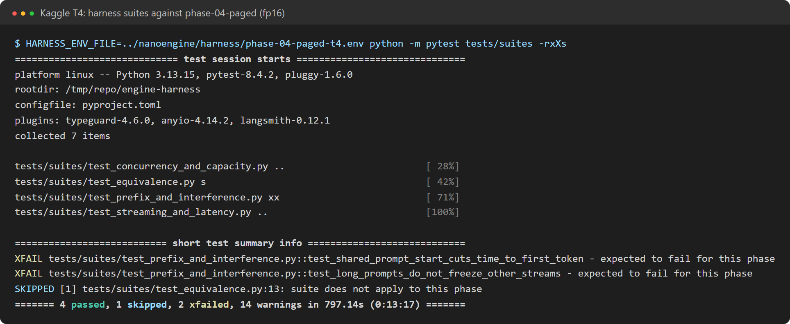
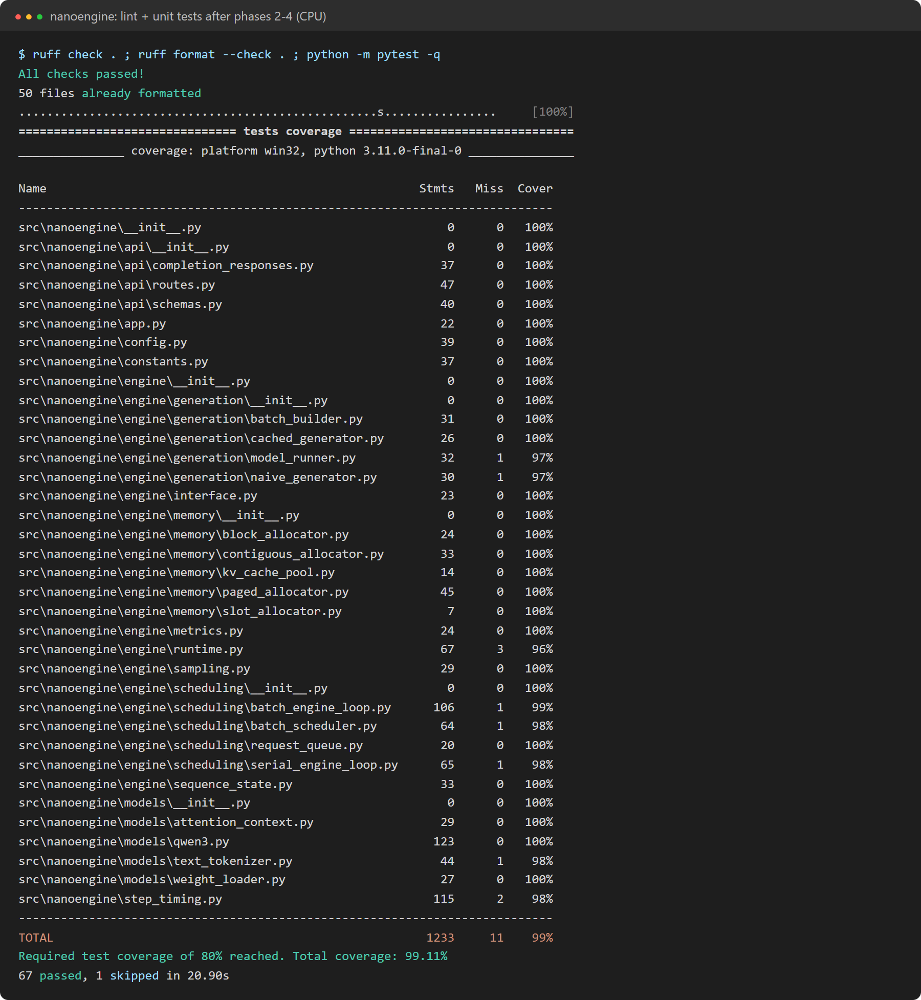

# Phase 4: paged KV cache

**Profile:** `phase-04-paged` (`kv_cache=paged`, `scheduler=continuous`, the same 4 GB budget as
phase 3, 16-token blocks).
**Code at the end of this phase:** `git checkout phase-04`.

The cache is cut into 16-token blocks. A sequence gets a new block only when its last one is full,
and a block table maps its positions to blocks anywhere in the pool. This is the memory manager of
PagedAttention. A sequence wastes at most one partly filled block, instead of reserving
`max_model_len` up front.

## What changed

| Module | Job |
|---|---|
| `engine/memory/block_allocator.py` | Free list of blocks: allocate, free, never hand one out twice |
| `engine/memory/paged_allocator.py` | Block tables. Expands them to one slot per token for attention: `table[p // 16] * 16 + p % 16` |
| `engine/scheduling/batch_scheduler.py` | Admits by free blocks. When the pool runs out mid-generation, it **preempts** the newest sequence: its blocks are freed, it goes back to the front of the queue, and it is recomputed later |

Attention did not change. It already read keys and values through slot numbers, so contiguous and
paged caches differ only in how slots are handed out.

## Results on a Kaggle T4 (fp16)

| Same 4 GB KV budget, short_chat at 64 users | Phase 3 (contiguous) | Phase 4 (paged) |
|---|---|---|
| Sequences in memory at once | 18 | **64** |
| Total tok/s | 394 | **1,028** |
| Time to first token p50 | 5.4 s (queued) | **0.45 s** |
| Preemptions | 0 | 3 |

Paging fits 3.6x more sequences in the same memory, which beats the plan's 2x criterion. That gives
2.6x the throughput, about **53% of vLLM's** 1,928 tok/s on the same GPU.

Still expected to fail at this phase (phase 5 targets both):
- **No prefix reuse.** A shared 512-token system prompt is recomputed for every request.
- **Long prompts freeze other streams.** Whole-prompt prefill steps stall decoding. Other users'
  inter-token p99 goes from 47 ms to 149 ms while 1,024-token prompts arrive.

### Before and after the sync fix

The fix described in [phase 2](phase-02-kv-cache.md#a-measured-mistake-one-cpugpu-stall-per-layer)
also helps here, most for single users:

| Phase 4 on a T4 | Before | After |
|---|---|---|
| short_chat, one user | 23.8 tok/s | 26.7 tok/s |
| short_chat, 64 users | 990 tok/s | 1,028 tok/s |

## Correctness

- **Property test (hypothesis):** after any sequence of reserve and free operations, used plus
  free blocks equal the total, and no block is owned twice.
- **Preemption:** with a pool too small for all requests, preempted sequences are recomputed, and
  every request still gets exactly the tokens it would get alone.
- **Real Qwen3-0.6B on CPU (fp32):** 10/10 identical outputs.

Full results: [T4](../results/phase-04-paged-t4/results/harness-report.md) ·
[T4 before the fix](../results/archive/phase-04-paged-t4-before-sync-fix/results/harness-report.md) ·
[CPU](../results/phase-04-paged-cpu/harness-report.md).
