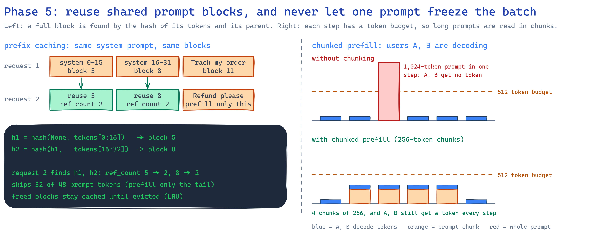
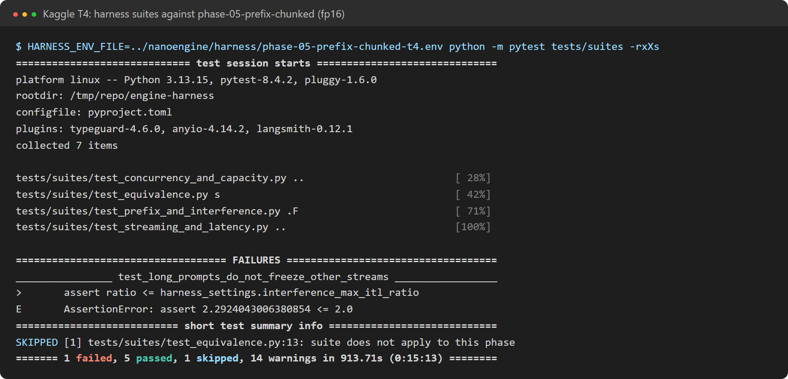

# Phase 5: prefix caching and chunked prefill

**Profile:** `phase-05-prefix-chunked`. It runs phase 4 (paged KV cache, continuous batching,
4 GB budget) with `prefix_cache=true`, `chunked_prefill=true` and `max_num_batched_tokens=256`.

## What changed

| Module | Job |
|---|---|
| `engine/memory/prefix_cache.py` | A full 16-token block is keyed by its tokens plus its parent block's key, so a key names a whole prefix. A new request walks its prompt block by block, shares every cached block by reference count, and computes only the rest. Freed blocks keep their content until the pool needs space (least recently used first) |
| `engine/scheduling/batch_scheduler.py` | `ChunkedPrefillScheduler`: each step decodes every running sequence and prefills prompt chunks within `max_num_batched_tokens` |
| `engine/scheduling/batch_engine_loop.py` | A step runs the decodes and the prompt chunks as two forward passes, so one-token decodes are not padded to the chunk length |

**No copy-on-write is needed.** Only full blocks are shared, and the last prompt token is always
recomputed, because its logits are needed to sample. So no step ever writes into a shared block.

## Results on a Kaggle T4 (fp16)

**Prefix caching works.** When 512 of 544 prompt tokens are shared, time to first token drops 67%
(141 → 46 ms). That beats the plan's 50% criterion. Over the run, 262,864 prompt tokens came from
the cache instead of being computed. On CPU with the real model, time to first token dropped 71%
(2,564 → 736 ms).

**Chunked prefill only partly works.** While 1,024-token prompts arrive, other users' inter-token
p99 rises 2.3x, against 3.2x in phase 4. That's an improvement, but the suite's threshold is 2.0x,
so it still fails. The plan's criterion (a 50% lower p99) is not met either.

| Phase 4 → phase 5 on a T4 | Phase 4 | Phase 5 |
|---|---|---|
| shared_prefix, 1 user: time to first token | 51 ms | **46 ms** |
| shared_prefix, 16 users: time to first token p50 | 601 ms | **228 ms** |
| long_prompt, 16 users: inter-token p99 | 1,102 ms | **177 ms** |
| short_chat, 64 users: tok/s | **1,028** | 602 |
| short_chat, 64 users: inter-token p50 | **61 ms** | 103 ms |

### An open problem: decode steps got slower

Throughput at 64 users fell from 1,028 to 602 tok/s. The step metrics locate the cost:
- **Not the extra chunk pass.** Steps with prompt chunks were rare (879 of about 61,000).
- **Plain decode steps got slower:** 44.8 ms on average vs 38.5 ms in phase 4, and 103 ms vs 61 ms
  at 64 users.

So one of the two features adds overhead to every decode step. This run turns both on, so it cannot
say which. Next steps:
1. Run each feature alone on the T4.
2. Profile the slower one.
3. Fuse decodes and prompt chunks into one forward pass, as vLLM does.

Until then, phase 5 is a latency win (time to first token, long-prompt stalls) and a throughput
loss.

## Correctness

- **Unit tests:** prefix caching alone, chunked prefill alone and both together give each request
  exactly the tokens it gets alone.
- **Property test (hypothesis):** reference counts never lose a block or count one twice.
- **Exact repeats:** a request that repeats a whole prompt still recomputes its last token.
- **Real Qwen3-0.6B on CPU:** 10/10 identical outputs. Prefix reuse passes (71% lower time to first
  token).

Full results: [T4](../results/phase-05-prefix-chunked-t4/results/harness-report.md) ·
[CPU](../results/phase-05-prefix-chunked-cpu/harness-report.md).
