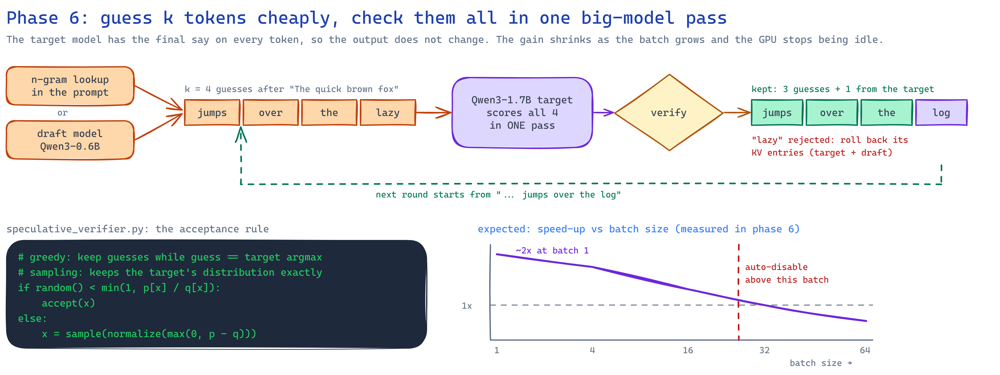
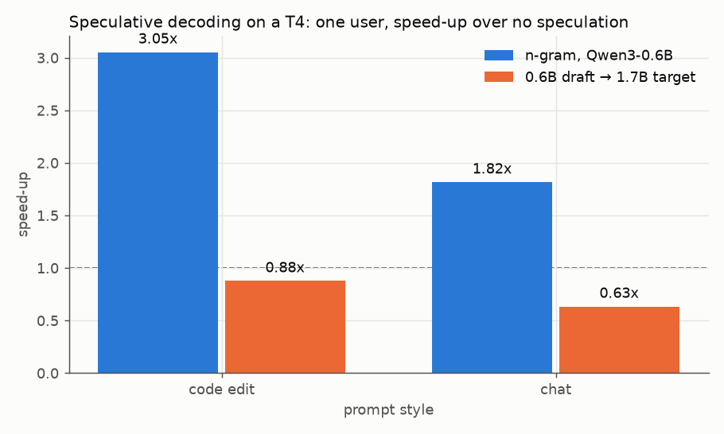
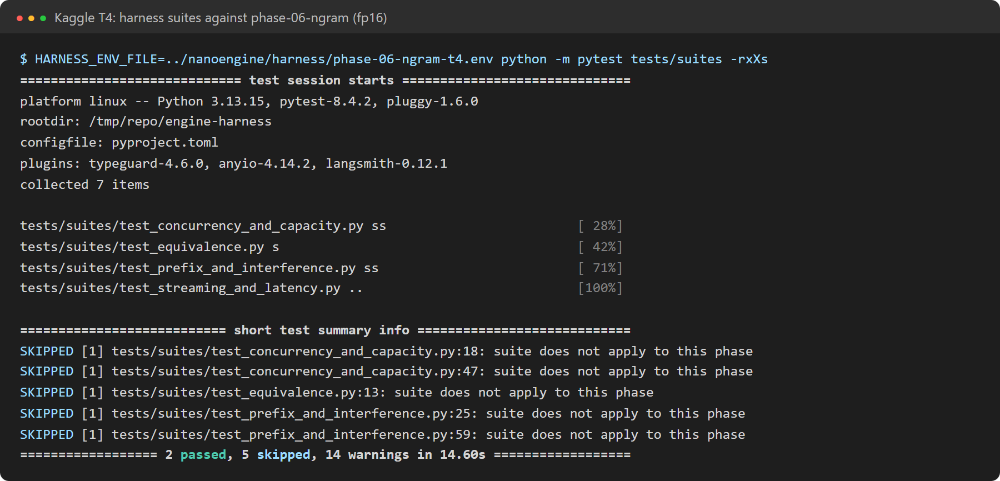

# Phase 6: speculative decoding

**Profiles:**
- `phase-06-ngram`: Qwen3-0.6B, prompt-lookup guesses.
- `phase-06-draft`: a Qwen3-1.7B target with a Qwen3-0.6B draft.

Both use `scheduler=serial` and 4 guesses per step.
**Code at the end of this phase:** `git checkout phase-06`.

A cheap proposer guesses the next k tokens. The target model scores the last real token plus all k
guesses in **one** pass and keeps a prefix of them. So one target pass can yield several tokens.

## What changed

| Module | Job |
|---|---|
| `engine/speculative/proposers.py` | `NgramProposer`: if the last tokens appeared before, guess what followed them. `DraftModelProposer`: a small model with its own KV cache, rolled back to the tokens the target kept |
| `engine/speculative/verifier.py` | Keeps guess `i` with probability `min(1, p/q)`. At the first rejection it redraws from `max(0, p − q)`. If every guess is kept, a bonus token comes from the target's last row. Greedy decoding reduces this to "keep the guesses that equal the target's argmax" |
| `engine/speculative/speculative_generator.py` | The serial loop. Rejected guesses' KV entries are dropped by moving `num_cached_tokens` back; later steps overwrite them |
| `speculative_benchmark.py` | One user's speed with and without speculation, on a code-edit prompt and a chat prompt |

## Results on a Kaggle T4 (fp16, one user)

| Proposer | Prompt | Baseline tok/s | Speculative tok/s | Speed-up | Guesses kept | Tokens per target pass |
|---|---|---|---|---|---|---|
| n-gram (0.6B) | code edit | 28.3 | **86.4** | **3.05x** | 57% | 3.20 |
| n-gram (0.6B) | chat | 28.1 | 51.1 | **1.82x** | 44% | 1.86 |
| 0.6B draft → 1.7B | code edit | 27.6 | 24.2 | 0.88x | 84% | 4.13 |
| 0.6B draft → 1.7B | chat | 27.7 | 17.5 | 0.63x | 54% | 3.05 |

**n-gram guesses are free and work well when the answer copies the prompt.** Code edits get 3x;
the plan's criterion (at least 1.5x on a repetitive workload) is met. In the harness, a single
user's short_chat speed went from 27.3 to 50.0 tok/s.

**A draft model that guesses well still makes things slower here.** This is the most useful finding of
the phase:
- The 0.6B draft is right 84% of the time, and each target pass yields 4.1 tokens.
- But in this engine every forward pass costs about 35 ms of kernel-launch overhead, whatever the
  model size. The 1.7B target runs at the same speed as the 0.6B (27.6 vs 28.3 tok/s).
- So the "small, cheap" draft is not cheap. Four draft passes plus one check cost about as much as
  five normal steps.

Speculation pays only when a draft pass is much cheaper than a target pass. That needs a GPU-bound
target (a bigger model) or a step without launch overhead (CUDA graphs, phase 7).

The inter-token latency of the speculative runs reads under 1 ms at p50 because kept guesses arrive
in bursts. Tokens per second is the meaningful number here.

## Correctness

- **Greedy:** n-gram, a different draft model and an identical draft model all give exactly the
  target's tokens. An identical draft has every guess kept.
- **Sampling:** a chi-square test on a 5-token vocabulary. The draft distribution is very different
  from the target's, yet verified tokens follow the target's distribution (6,000 draws, p > 0.001).
- **Real Qwen3-0.6B on CPU, n-gram:** 10/10 identical outputs, 2x faster (4.9 → 10.0 tok/s).

**Not done:** speculation runs only with the serial scheduler. The plan's study of the batch size
where speculation stops paying (and auto-disabling above it) is left for later. In a batch, the GPU
is already busy, so extra guesses cost real compute.

Full results: [n-gram](../results/phase-06-ngram-t4/results/speculative-benchmark.md) ·
[draft](../results/phase-06-draft-t4/results/speculative-benchmark.md) ·
[CPU](../results/phase-06-ngram-cpu/harness-report.md).
